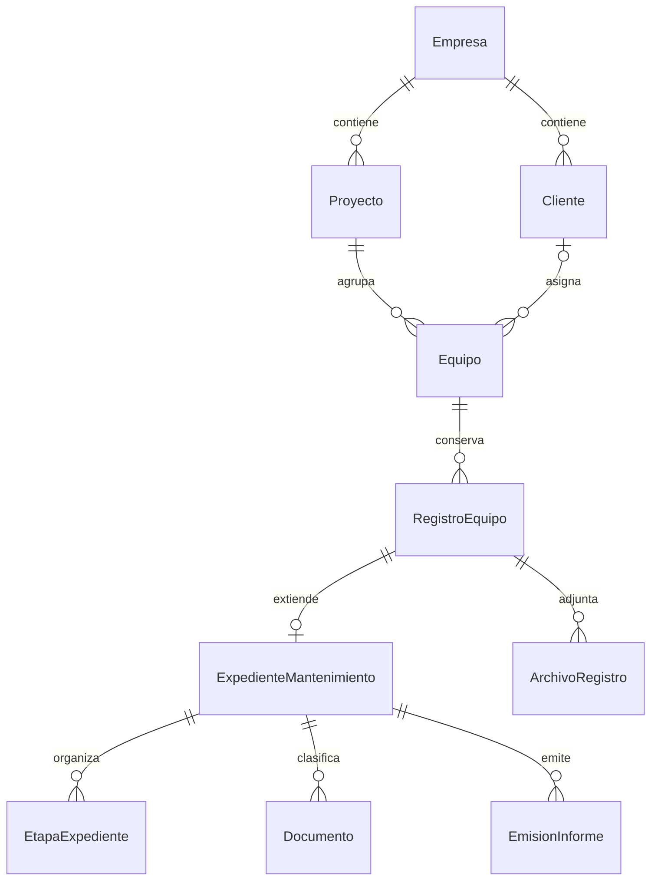

# Arquitectura de expedientes de mantenimiento

Fecha: 2026-11-05. Estado: propuesta de Fase 1, pendiente de validación funcional. Este documento no autoriza implementación ni modifica el comportamiento actual.

## Alcance y evidencia

Diseño basado en el código de `sistema/` y en los requerimientos entregados en la conversación. No se encontró `MASISCAM_Borrador_Textual_Integro_Propuesta_Desarrollo.pdf` en el proyecto; no se presume aprobado su contenido no disponible. No se verificaron PostgreSQL, Drive, Redis ni workers del despliegue. La auditoría previa encontró la SQLite local sin tablas; no demuestra el estado productivo.

| Componente existente | Dependencias y capacidad verificada | Integración propuesta |
| --- | --- | --- |
| Cliente | Empresa; RUC único por empresa; Equipo y RolMasiscam lo referencian con PROTECT | Reutilizar; no copiar catálogo. Congelar datos de identificación en emisiones |
| Equipo | Proyecto determina empresa; cliente opcional; tipo REDUCTOR/BOMBA; token único; datos técnicos y dos fotografías | Identidad permanente. Un equipo conserva QR y admite múltiples intervenciones |
| RegistroEquipo | FK Equipo; tipos NUEVO/ASISTENCIA/GARANTIA/MANTENIMIENTO/REPARACION; fecha, observación, UUID, secuencia y carpeta Drive | Base histórica de cada intervención; extensión opcional OneToOne |
| ArchivoRegistro | FK RegistroEquipo; hash único por registro, MIME, tamaño, ID Drive reservado y estado de carga | Reutilizar para fotografías y evidencias, sin duplicar bytes |
| Documento | Proyecto obligatorio, Equipo opcional; archivo local, categoría, hash, IDs Drive y estado | Reutilizar para documentos formales e informes; añadir relación opcional al expediente y clasificación/versionado |
| RolMasiscam | OneToOne Perfil; Perfil une usuario y empresa; CLIENTE requiere Cliente | Mantener códigos heredados y añadir roles operativos mediante el mismo sistema |
| Auditoria | Empresa, Proyecto opcional, usuario, objeto, acción, detalle JSON | Reutilizar; añadir referencia opcional a expediente y eventos de negocio |
| QR | Token de Equipo; rutas actuales y legacy; resolución principal exige sesión y autorización | Conservar tokens y rutas; el expediente no reemplaza la identidad del equipo |
| Drive/Celery | Señales post_save/on_commit; services/tasks; reservas de IDs y reintentos | Tareas idempotentes posteriores a commit; ningún cambio remoto durante migraciones |

Fuentes: `masiscam/models.py`, `forms.py`, `views.py`, `urls.py`, `public_urls.py`, `access.py`, `usuario_forms.py`, `usuario_views.py`; `accounts/models.py`, `middleware.py`; `config/urls.py`, `settings.py`; todas las rutas relativas a `sistema/`.

Las plantillas `ficha_detalle.html`, `_registros_lista.html`, `_identificacion_datos.html` y `equipo_publico.html` reutilizan identificación e historial. `equipo_informe` devuelve HTML; `requirements.txt` no declara motor PDF. El dashboard actual agrupa productos, no etapas. Existen pruebas de clientes, roles, QR, documentos, aislamiento, orden y Drive; no se ejecutaron en esta fase.

## Decisión: combinación de modelos

Crear `ExpedienteMantenimiento.registro = OneToOneField(RegistroEquipo, on_delete=PROTECT)` con relación inversa `expediente_mantenimiento`. Un registro puede no tener expediente; un expediente siempre tiene exactamente un registro. Equipo se obtiene de `registro.equipo`, sin un segundo FK contradictorio.

No convertir todos los registros históricos en expedientes. Para nuevos expedientes se admiten MANTENIMIENTO y REPARACION; ampliar a GARANTIA exige decisión funcional. Los demás registros conservan sus pantallas y comportamiento salvo las protecciones cuando haya referencias aprobadas.

Cliente contractual se fija mediante FK protegido en el expediente y una instantánea de recepción. Debe coincidir con Equipo.cliente al abrirlo. Un cambio posterior de dueño del equipo no reasigna expedientes pasados. Empresa del expediente se fija al crearlo y se valida contra el proyecto del equipo. Es una frontera de seguridad almacenada, no otra identidad del equipo. Mover un equipo de empresa con expedientes queda prohibido por el servicio; un traslado futuro necesita un proceso explícito.

## Identificación inmutable

Propuesta: `numero` globalmente único con formato `EXP-<UUID completo>`, generado en servidor y sin posibilidad de edición. No deriva del token QR, fecha, número de serie ni secuencia del registro. La elección de formato humano correlativo queda pendiente; no se añade contador hasta aprobarla. No usar MAX+1. Una restricción UNIQUE evita colisiones y un control PostgreSQL futuro impide UPDATE de número/registro/empresa/cliente contractual.

El UUID de `clave_creacion` existente continúa siendo clave de idempotencia del alta de RegistroEquipo, no el número visible del expediente. Las secuencias cronológicas pueden seguir cambiando; las referencias oficiales siempre usan `numero` e ID estable.

## Servicios y consistencia

Servicios propuestos: abrir expediente, asignar responsable, guardar revisión, enviar a revisión, decidir aprobación, registrar repuestos, emitir informe y cerrar. Cada operación comprueba sesión, rol activo, empresa activa, objeto autorizado, estado, versión esperada y evidencia requerida. Todos los caminos de escritura (vistas, admin, tareas, comandos e importaciones) deben respetar el contrato.

En transición: `transaction.atomic`, bloqueo del expediente/etapa en orden estable, control de revisión y evento de auditoría en la misma transacción. Las tareas reciben IDs, nunca decisiones autorizadas desde el navegador. Revalidan estado/revisión al ejecutarse. No mantener transacciones abiertas durante generación PDF o llamadas Drive.

Preparación de emisión: reservar una emisión con clave idempotente y datos congelados bajo bloqueo; generar fuera de la transacción; confirmar hash/archivo y revisión bajo nuevo bloqueo. Si hubo cambios, no publicar la emisión como vigente. Separar estado de negocio del estado de generación/sincronización.

## Documentos y Drive

Preservar carpetas e IDs actuales. `services.py` crea jerarquía cliente/tipo/serie; `registro_orden.py` organiza tipo/fecha/secuencia y puede mover carpetas conservando IDs. Asociar el expediente a la carpeta del registro existente; no crear una raíz duplicada ni renombrar históricos para introducir el número.

Agregar clasificación lógica y, cuando se implemente, subcarpetas nuevas dentro del registro solo si no afectan recorridos/propiedad. Las categorías actuales de Documento continúan siendo válidas. Los documentos comerciales se mantienen privados; CLIENTE solo ve emisiones/evidencias expresamente publicadas de sus expedientes autorizados, no todo el contenido de una carpeta.

ArchivoRegistro hoy transmite bytes de la petición a Drive y no conserva copia local. Su reintento puede requerir reselección. Para documentos emitidos se reutiliza Documento con contenido persistido antes de encolar; no prometer que Celery recuperará un archivo perdido. Respaldos y retención se validan antes de producción.

## Conservación y compatibilidad

- Ninguna migración de diseño borra, renumera o reemplaza equipos, registros, tokens, documentos o IDs de Drive.
- OneToOne con PROTECT bloquea el borrado de RegistroEquipo desde el ORM y cascadas superiores cuando tiene expediente. Las acciones remotas destructivas deben comprobar protección ANTES de llamar a Drive.
- Los expedientes no tienen borrado físico funcional. Se anulan con motivo y evento; cerrados son de solo lectura. Correcciones posteriores mediante adenda/nueva revisión autorizada, nunca sobrescritura de la emisión anterior.
- Referencias a evidencias, planos y documentos aprobados con PROTECT; prohibir sustituir bytes, cambiar propietario, archivar para eludir controles o eliminar desde rutas legacy.
- Model.clean/save y formularios no bastan frente a update/bulk/raw SQL. Planificar guardas PostgreSQL para identidad inmutable y modificaciones de datos congelados, y permisos de DB sin TRUNCATE/DDL para la aplicación. Un administrador de infraestructura aún puede intervenir: backups, auditoría y controles operativos son necesarios.
- Mantener rutas/plantillas existentes para registros sin expediente. Añadir futuras pantallas sin cambiar el significado de ACTIVO/INACTIVO/MANTENIMIENTO del equipo.

## Entregables relacionados y alcance siguiente

Consultar [roles](matriz_roles_permisos.md), [flujo](flujo_estados_mantenimiento.md), [datos](diccionario_datos.md), [migraciones](plan_migraciones.md) y [validaciones](riesgos_y_validaciones.md).

Fase 2 propuesta: recepción, expediente, aislamiento, protección y guía de ingreso; no implementar aún todo el ciclo. El diseño está preparado para revisión. Inicio condicionado a autorización expresa y cierre de los pendientes bloqueantes de esa fase.
